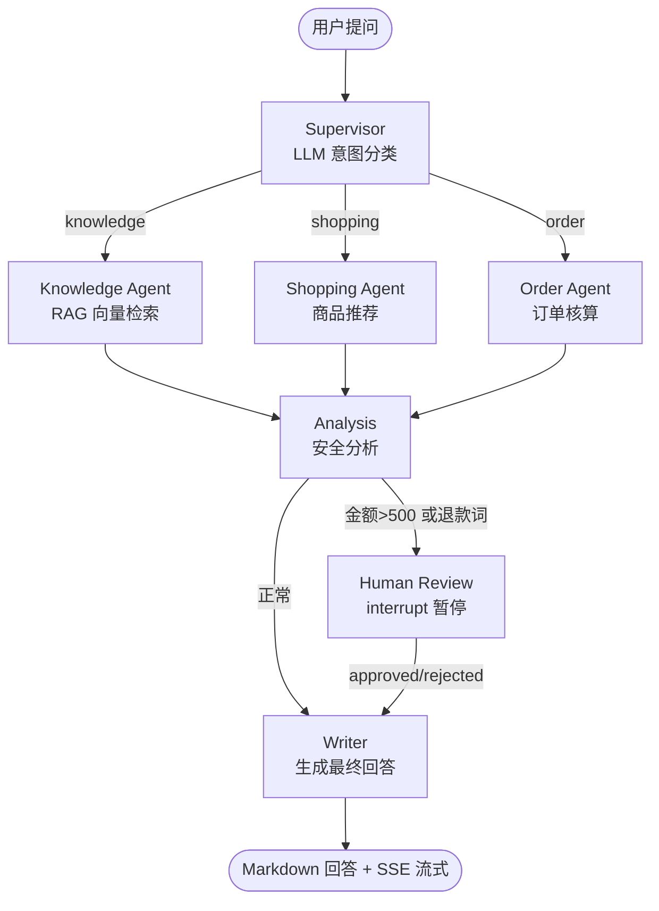
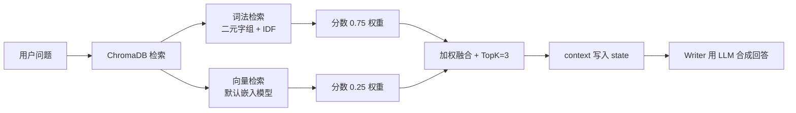
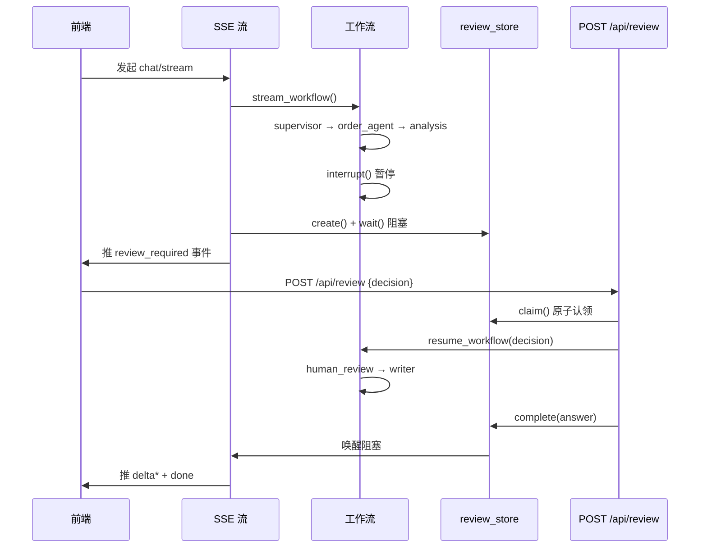

# PetPals AI 助手 · 面试详解

> 本文档专为面试准备，深入讲解项目里 AI 部分的设计思路、关键代码、面试高频问答与弱点应对。
> 源码位置：`backend/agents/`。配合 [README.md](README.md) 一起看。

---

## 一、整体架构

PetPals 的 AI 助手是一个**基于 LangGraph 的多 Agent 状态图**，由 7 个节点组成，带人工审核（Human-in-the-loop）能力。

### 工作流拓扑



### 关键设计点

| 点 | 做法 | 为什么 |
|---|---|---|
| **多 Agent 而非单 Agent** | 意图路由 + 专职 Agent | 职责分离、可调试、可降级、成本低 |
| **LLM 可降级** | 全链路 Optional，无 Key 也能跑 | 本地演示、网络故障仍可用 |
| **Human-in-the-loop** | LangGraph interrupt + MemorySaver | 订单/退款类操作需人工把关 |
| **SSE 流式** | event: progress/delta/done | 类 ChatGPT 打字机体验 |
| **RAG 混合检索** | 词法 0.75 + 向量 0.25 | 默认嵌入对中文宠物领域弱，词法更可靠 |

---

## 二、7 个节点逐一详解

图组装在 [graph.py:35-72](backend/agents/graph.py#L35-L72)，节点实现在 [nodes.py](backend/agents/nodes.py)。

### 2.1 Supervisor — 意图分类

**职责**：拿到用户问题，判断属于 `knowledge` / `shopping` / `order` 哪类，路由到对应 Agent。

**实现**：优先调 [llm.py:58-89](backend/agents/llm.py#L58-L89) 的 `classify_intent()` 用 LLM 分类；LLM 不可用或返回非法值时，回退到关键词匹配（`_ORDER_KEYWORDS` / `_KNOWLEDGE_KEYWORDS` / `_SHOPPING_KEYWORDS`）。

**面试 Q**：为什么不直接让一个 LLM Agent 处理所有问题？
**A**：① 可控性——单 Agent 自主决策不可控、可复现性差；② 职责分离——三类任务对应不同工具集和 prompt，单独调试；③ 降级灵活——意图分类可以 LLM 也可以关键词，互不影响；④ 延迟与成本——多 Agent + 确定性路由通常只调 1-2 次 LLM，单 Agent ReAct 循环要多次 LLM 调用。

### 2.2 Knowledge Agent — RAG 知识检索

**职责**：从 ChromaDB 向量库检索相关文档片段，供 Writer 合成自然语言回答。

**实现**：调 [tools.py](backend/agents/tools.py) 的 `search_pet_care` 工具，混合检索 TopK=3 片段写入 `context` 字段。

### 2.3 Shopping Agent — 商品推荐

**职责**：按用户关键词查商品库，返回结构化推荐列表。

**实现**：调 `recommend_products` 工具，**实时读数据库**（不硬编码），返回 `[{id, name, price, category, suitable, stock, tags}]`。

### 2.4 Order Agent — 订单核算

**职责**：解析用户想下单的商品和数量，调工具算总价、查配送、报时间。

**实现**：用正则 + 子串匹配从自然语言里提取商品名和数量（**不让 LLM 解析**，钱相关必须确定性），调 `calculate_total`（实时单价）+ `check_delivery`（库存+运费+时效）+ `get_current_time`。

**面试 Q**：订单为什么不让 LLM 解析？
**A**：钱相关操作必须确定性、可复现，LLM 输出不稳定。用正则 + 子串匹配 + 数据库实时单价，安全可控，每次相同输入得到相同输出。

### 2.5 Analysis — 安全分析

**职责**：检查 Agent 输出是否触发风控规则，决定是否需要人工审核。

**规则**：金额 > 500 元 **或** 出现"退款/投诉/取消订单"等敏感词 → `needs_review=True`，路由到 `human_review`。

### 2.6 Human Review — 人工审核（核心亮点）

**职责**：用 LangGraph 的 `interrupt()` **暂停整个工作流**，等用户决策后用 `Command(resume=...)` 恢复。

**实现**：[nodes.py](backend/agents/nodes.py) 的 `human_review_node` 调 `interrupt()` 抛出审核 payload（包含原因、订单详情等），图在此冻结。用户在前端点"确认/驳回"后，`POST /api/review` 用 [graph.py:123-145](backend/agents/graph.py#L123-L145) 的 `resume_workflow()` 恢复。

**面试 Q**：人工审核是怎么实现的？
**A**：LangGraph 的 `interrupt()` + `MemorySaver` checkpointer。图在 `human_review_node` 暂停，前端拿到 `review_required` 事件，用户决策后 `POST /api/review` 用 `Command(resume=...)` 恢复。SSE 流和审核接口通过进程内 `review_store` 桥接，`claim()` 原子认领防并发重复恢复。

### 2.7 Writer — 回答生成

**职责**：把前面节点收集的信息（context / product_results / order_lines / review_decision）合成最终 Markdown 回答。

**实现**：知识类用 [llm.py:110-133](backend/agents/llm.py#L110-L133) 的 `generate_knowledge_answer()` 让 LLM 基于检索片段合成；LLM 失败回退模板。商品/订单类用结构化表格 + LLM 摘要。

---

## 三、WorkflowState 状态管理

定义在 [state.py](backend/agents/state.py)，用 TypedDict，每个节点只更新自己负责的字段，LangGraph 自动合并。

```python
class WorkflowState(TypedDict, total=False):
    user_id: Optional[int]        # 输入
    question: str
    intent: str                   # Supervisor 写入
    context: List[str]            # Knowledge Agent 写入
    product_results: List[dict]   # Shopping Agent 写入
    order_lines: List[dict]       # Order Agent 写入
    total: float
    delivery_info: dict
    needs_review: bool           # Analysis 写入
    review_decision: Optional[str] # Human Review 写入
    answer: str                   # Writer 写入
```

**面试 Q**：状态怎么在节点间传递？
**A**：`WorkflowState` TypedDict + LangGraph 自动合并。每个节点只更新自己负责的字段，返回 dict 用 `**` merge 语义合并进全局状态。

---

## 四、RAG 链路

### 流程



### 关键细节

- **混合检索**：词法 0.75 + 向量 0.25。默认嵌入模型对中文宠物领域词语义区分弱，词法二元字组 + IDF 加权是更可靠的强信号，向量补近义召回。
- **TopK=3**：上下文窗口和回答字数限制，生产可调大。
- **检索为空时不调 LLM**：走模板回答，避免 LLM 编造。
- **强制免责声明**：健康相关问题结尾加"以执业兽医意见为准"。

**面试 Q**：怎么防止 LLM 编造？
**A**：① Prompt 显式约束"只依据参考资料"；② 检索为空时不调 LLM，走模板；③ 强制结尾加免责声明；④ temperature=0.3 偏低，减少随机性。

---

## 五、Human-in-the-loop 详解

### 审核桥接：review_store 的角色

SSE 流式接口和审核接口是**两个独立的 HTTP 请求**，怎么让审核结果"唤醒"正在阻塞等待的 SSE 流？

答案：用一个进程内的 `review_store`（[agents/review.py](backend/agents/review.py)）做桥接：

1. SSE 流跑到 `interrupt` 时调 `review_store.create()` 注册审核单，然后 `review_store.wait()` **阻塞等待**；
2. 用户调 `POST /api/review` 时调 `review_store.claim()` **原子认领**（防止重复恢复），跑完 `resume_chat()` 后调 `review_store.complete()` 把答案塞回去；
3. 阻塞中的 SSE `wait()` 被唤醒，拿到答案继续推 `delta` 增量 + `done` 事件。

### SSE / 审核时序



### 4 个边界处理

1. **`claim()` 原子互斥**：防止用户连点两下"通过"，重复 `Command(resume=...)`。
2. **SSE 超时自动驳回**：审核一直没人响应，SSE 线程自己用 `rejected` 恢复图，避免 interrupt 永久占内存。
3. **竞速保护**：`wait()` 超时但审核请求恰好抢先认领了，再等一轮 30s，避免误判超时。
4. **`has_pending_interrupt` 双重校验**：校验后并发抢先恢复会抛 `RuntimeError`，捕获后返回 409 而不是 500。

---

## 六、SSE 流式输出

实现在 [routers/chat.py](backend/routers/chat.py) 的 `chat_stream`。事件序列：

```
thread → progress* → [review_required → 阻塞 → progress] → delta* → done
```

### 4 个工程细节

1. **进度最短停留 0.25s**：避免节点执行过快导致前端进度条闪烁——前端体验工程。
2. **答案按 8 字一块打字机推送**：每块 `time.sleep(0.02)`，模拟 ChatGPT 的流式打字感。
3. **独立 Session**：SSE 生成器跑在 anyio 工作线程，请求级 Session 非线程安全，必须新开 `SessionLocal()` 并在 `finally` 关闭。
4. **`X-Accel-Buffering: no`**：响应头关掉 nginx 代理缓冲，否则事件会被攒一批再发。

**面试 Q**：SSE vs WebSocket 怎么选？
**A**：SSE 是**单向**（服务器→客户端），用标准 HTTP，被代理/防火墙友好，足够 AI 助手这种"服务端推、客户端只发问"的场景；WebSocket 是**双向**，适合聊天室、协同编辑。我们只需要服务端推 token，SSE 更轻量。

---

## 七、LLM 封装与降级策略

[llm.py](backend/agents/llm.py) 是整个 AI 部分的"安全网"。三个核心函数：

| 函数 | 用途 | 失败降级 |
|---|---|---|
| `get_llm()` | 懒加载 `ChatOpenAI` 单例 | 无 key 或初始化失败 → 返回 `None` |
| `classify_intent()` | LLM 意图分类 | 输出非法或调用失败 → `None`，由关键词兜底 |
| `generate_knowledge_answer()` | RAG 回答合成 | 失败 → `None`，Writer 回退模板 |

**面试 Q**：为什么把 LLM 调用都包成 `Optional` 返回 `None`？
**A**：① **降级隔离**：LLM 是网络依赖，任何环节挂掉都不应该让整个请求失败；② **本地可跑**：没配 API Key 也能 `docker-compose up` 起来演示；③ **失败可观测**：所有 LLM 调用都 try/except + `logger.warning`，不向调用方抛异常。

**追问：用 ChatOpenAI 而不是 OpenAI 官方 SDK？**
**A**：ChatOpenAI 是 LangChain 的封装，**兼容任何 OpenAI 协议网关**（智谱 GLM、DeepSeek、通义、本地 vLLM 都行），只换 `base_url` + `api_key` 就能切模型，不绑死某一家的 SDK。

---

## 八、5 个 @tool 工具

[tools.py](backend/agents/tools.py) 用 `langchain_core.tools.tool` 装饰器定义了 5 个工具：

| 工具 | 职责 | 实时读库 |
|---|---|---|
| `search_pet_care` | 养宠知识向量检索 | 否（ChromaDB） |
| `recommend_products` | 商品推荐 | 是（Product 表） |
| `calculate_total` | 订单金额核算 | 是（实时单价） |
| `check_delivery` | 配送评估（运费 + 时效 + 库存） | 是（库存） |
| `get_current_time` | 当前时间 | 否（系统时间） |

**面试 Q**：工具为什么用 `@tool` 装饰器？
**A**：① 给 LangChain 生态留接入位——未来要换成 `bind_tools` 让 LLM 自主调用工具，这些 `@tool` 函数直接就能用；② 装饰器自动提取 docstring 作为工具描述；③ 当前是**确定性调用**（节点里手动 `tool.invoke(payload)`），不是让 LLM 自己决定调哪个——订单/商品这种"硬任务"必须确定性。

---

## 九、面试高频问答汇总

照这个顺序背：

### Q1：这个项目用了什么 AI 框架？为什么选它？
LangGraph（基于 LangChain）。原因是它**原生支持图结构编排多 Agent + interrupt/resume 机制**，这是 Human-in-the-loop 的关键。如果用纯 LangChain AgentExecutor，做暂停-恢复要自己造轮子。

### Q2：为什么用多 Agent 而不是单 Agent？
- **可控性**：单 LLM Agent 自主决策不可控、可复现性差；
- **职责分离**：知识/商品/订单三类任务对应不同工具集和 prompt；
- **降级灵活**：意图分类可以 LLM 也可以关键词；RAG 回答可以 LLM 也可以模板；
- **延迟与成本**：多 Agent + 确定性路由通常只调 1-2 次 LLM。

### Q3：RAG 怎么做的？为什么用混合检索？
词法 0.75 + 向量 0.25。默认嵌入模型对中文宠物领域词语义区分弱，词法二元字组 + IDF 加权是更可靠的强信号，向量补近义召回。

### Q4：怎么防止 LLM 编造？
Prompt 显式约束"只依据参考资料"；检索为空时不调 LLM，走模板；强制结尾加免责声明；temperature=0.3 偏低。

### Q5：人工审核是怎么实现的？
LangGraph 的 `interrupt()` + `MemorySaver` checkpointer。图在 `human_review_node` 暂停，前端拿到 `review_required`，用户决策后 `POST /api/review` 用 `Command(resume=...)` 恢复。SSE 流和审核接口通过进程内 `review_store` 桥接，`claim()` 原子认领防并发重复恢复。

### Q6：SSE 流式怎么做的？为什么不用 WebSocket？
SSE 是单向、用标准 HTTP、对代理友好，足够"服务端推 token"的场景。

### Q7：LLM 挂了怎么办？
全链路降级：`get_llm()` 返回 `None` → `classify_intent` 返回 `None` → 关键词路由兜底 → RAG 回答 LLM 失败 → Writer 模板回答。整个应用无 LLM 也能跑。

### Q8：订单为什么不让 LLM 解析？
钱相关操作必须确定性、可复现，LLM 输出不稳定。用正则 + 子串匹配 + 数据库实时单价，安全可控。

### Q9：状态怎么在节点间传递？
`WorkflowState` TypedDict + LangGraph 自动合并。每个节点只更新自己负责的字段。

### Q10：项目里最难的部分是什么？
两个候选：
- **混合检索的调参**：0.75:0.25 权重、IDF 加权、停用词剔除，基于默认嵌入模型对中文弱倒推；
- **Human-in-the-loop 的并发处理**：`claim()` 互斥、SSE 超时自动驳回、竞速再等一轮——边界情况多。

---

## 十、可能被问倒的弱点（提前想好）

1. **ChromaDB 是单机内存**：`MemorySaver` 和 `review_store` 都是进程内，**多 worker 部署会失效**。诚实说"这是 demo 限制，生产要换 Redis/Postgres 持久化 checkpointer，review_store 改成 Redis pub/sub"。
2. **LLM 输出格式校验**：意图分类靠 JSON 解析，模型偶尔输出 ```json 代码块，代码里有兼容处理，但**没有用结构化输出**（如 `with_structured_output`），可以追问"为什么不用"——答"考虑过，但想保持降级灵活性"。
3. **检索 TopK=3 偏少**：生产可调大；当前选 3 是因为上下文窗口和回答字数限制。
4. **意图只有三类**：实际场景会有售后、物流查询、闲聊等更多类，可以做层次化分类。
5. **没有评估集**：没有标准的 RAG 评估指标（faithfulness、answer relevancy），目前靠人工测试。可以提"接入 RAGAS 或 LangSmith 做评估"。

---

## 十一、速记卡（面试前 5 分钟翻一遍）

1. **框架**：LangGraph（图结构 + interrupt/resume）+ LangChain（工具/LLM 封装）+ ChromaDB（本地向量库）
2. **节点数**：7 个（supervisor / knowledge / shopping / order / analysis / human_review / writer）
3. **意图路由**：LLM 优先，关键词兜底，三类（knowledge/shopping/order）
4. **RAG 检索**：混合，词法 0.75 + 向量 0.25，TopK=3
5. **LLM 模型**：智谱 GLM-4-Flash，ChatOpenAI 兼容 OpenAI 协议网关
6. **降级**：全链路 Optional，无 Key 也能跑
7. **人工审核**：interrupt() + MemorySaver + Command(resume=...)
8. **审核桥接**：review_store 进程内桥接 SSE 和审核接口
9. **并发保护**：claim() 原子认领 + SSE 超时自动驳回 + 竞速再等一轮
10. **流式**：SSE，event: progress/delta/done
11. **打字机**：8 字一块，每块 sleep 0.02s
12. **独立 Session**：SSE 生成器跑在 anyio 线程，必须新开 Session
13. **工具**：5 个 @tool，订单/商品实时读库
14. **订单解析**：正则 + 子串匹配，不让 LLM 碰钱
15. **temperature**：0.3，偏低减少随机性
16. **prompt 约束**：只依据参考资料，不编造
17. **免责声明**：健康问题结尾加"以执业兽医意见为准"
