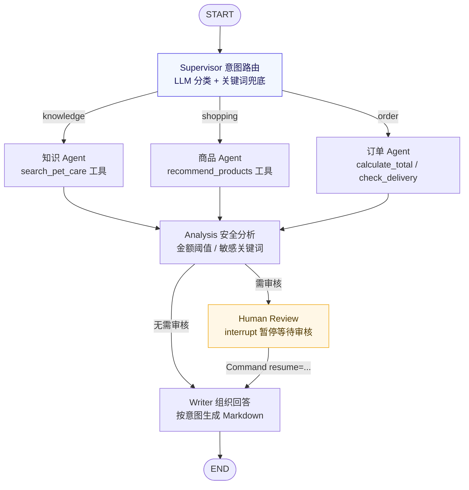
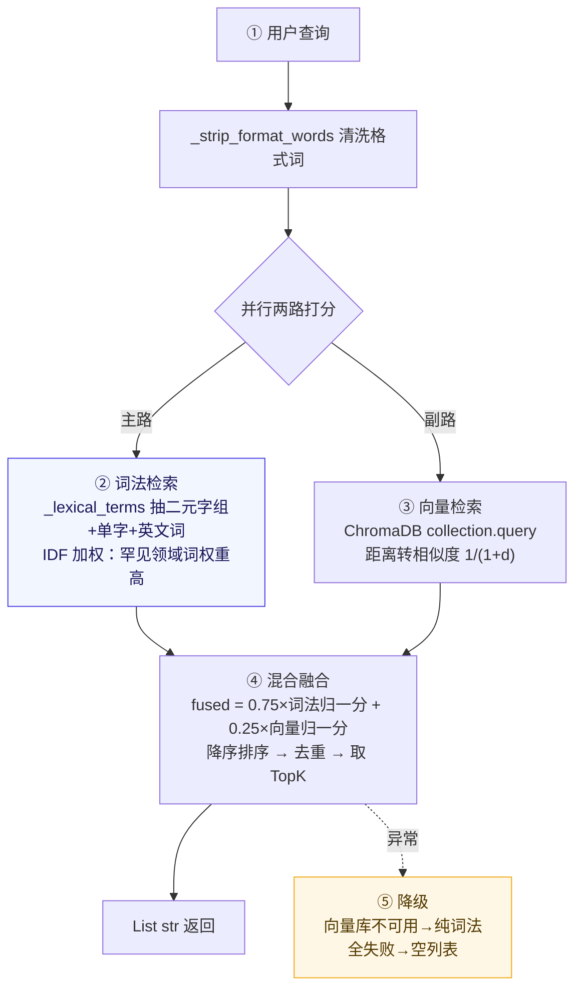
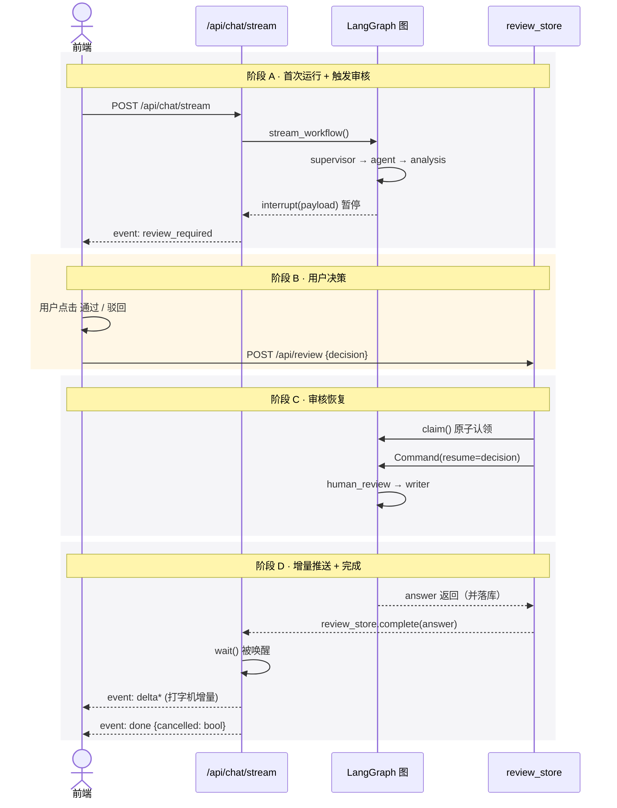

# PetPals AI 助手面试详解

> 本文档系统讲解 PetPals 项目 AI 部分的架构、实现细节与面试高频问答。
> 配合源码阅读效果最佳，所有代码引用均带相对路径与行号。
> 适用读者：项目作者本人（准备 AI 智能应用开发实习面试）。

---

## 目录

1. [整体架构](#1-整体架构)
2. [工作流节点详解](#2-工作流节点详解)
3. [状态管理：WorkflowState](#3-状态管理workflowstate)
4. [RAG 链路（核心亮点）](#4-rag-链路核心亮点)
5. [Human-in-the-loop 人工审核（项目最大亮点）](#5-human-in-the-loop-人工审核项目最大亮点)
6. [SSE 流式输出](#6-sse-流式输出)
7. [LLM 封装与降级策略](#7-llm-封装与降级策略)
8. [5 个 @tool 工具](#8-5-个-tool-工具)
9. [面试高频问答汇总](#9-面试高频问答汇总)
10. [可能被问倒的弱点](#10-可能被问倒的弱点)
11. [速记卡（面试前 5 分钟翻一遍）](#11-速记卡面试前-5-分钟翻一遍)

---

## 1. 整体架构

AI 助手本质是**基于 LangGraph 的多 Agent 工作流**，跑在 FastAPI 后端，对外三个接口：

| 接口 | 方法 | 作用 |
|---|---|---|
| `/api/chat` | POST | 一次性问答，触发审核时返回 `review_required` |
| `/api/chat/stream` | POST | SSE 流式对话，推送进度 / 审核单 / 增量回答 |
| `/api/review` | POST | 人工审核确认，用 `Command(resume=...)` 恢复图 |

核心代码分布：

| 文件 | 职责 |
|---|---|
| `backend/agents/state.py` | 定义 `WorkflowState`，节点间共享"黑板" |
| `backend/agents/nodes.py` | 7 个节点函数 |
| `backend/agents/graph.py` | 用 `StateGraph` 把节点连成图，挂 `MemorySaver` |
| `backend/agents/tools.py` | ChromaDB 写入/检索 + 5 个 `@tool` 工具 |
| `backend/agents/llm.py` | 封装 `ChatOpenAI`，意图分类 + RAG 回答生成 |
| `backend/agents/review.py` | 进程内审核桥接（`review_store`） |
| `backend/routers/chat.py` | 对外 HTTP 接口 |

### 工作流拓扑图



对应源码：`backend/agents/graph.py:35-72` 的 `build_graph()`。

**一句话总结架构**：用户问题进入图后，先经 Supervisor 分类意图，路由到三个专职 Agent 之一处理；三个 Agent 汇到 Analysis 节点做安全分析；需要审核就 `interrupt` 暂停等用户决策，否则直达 Writer 组织最终 Markdown 回答。

---

## 2. 工作流节点详解

### 2.1 Supervisor —— 意图路由节点（图的"大脑"）

**源码**：`backend/agents/nodes.py:114-132`

**做的事**：把用户问题分类成 `knowledge / shopping / order` 三种意图之一，写到 `state["intent"]`。

**实现：LLM 优先 + 关键词兜底双保险**：

1. 先调 `llm_helper.classify_intent(q)`，让大模型输出 JSON `{"intent": "..."}`；
2. 如果返回 `None`（没配 key、调用失败、输出非法值），回退到关键词匹配：先查订单词（"下单/付款/物流"...）、再查知识词（"疫苗/驱虫/细小"...）、再查购物词，都没有就默认 `knowledge`。

**面试 Q：为什么要做双保险？**
> 生产环境 LLM 不稳定（限流、超时、输出格式漂移），关键词兜底保证任何情况下意图路由都能给出可用结果，应用不会因为 LLM 故障就完全瘫掉。这是典型的**优雅降级**思路。

**追问：为什么不直接让一个 LLM Agent 自己决定调哪个工具？**
> 单 Agent 自主决策听起来"更智能"，但：① 不可控，可能乱调工具或反复调；② 调用链长、延迟高、token 消耗大；③ 出问题难复现。我们用**显式 Supervisor + 专职 Agent**的多 Agent 模式，意图分类这一步是**确定性分支**，下游每个 Agent 只做一类事，可控、可调试、可降级。

### 2.2 三个专职 Agent

#### Knowledge Agent —— RAG 检索

**源码**：`backend/agents/nodes.py:170-174`

调用 `search_pet_care` 工具做向量检索，返回 TopK 资料片段写到 `state["context"]`。

**细节**：先用 `_strip_format_words()` 把"请你/帮我/Markdown/表格"这类格式词洗掉再去检索，避免"请用 Markdown 整理幼犬疫苗时间表"整句原样进向量库拉低相关度。

#### Shopping Agent —— 商品推荐

**源码**：`backend/agents/nodes.py:231-286`

调用 `recommend_products` 工具，**实时读数据库**而不是硬编码推荐。

**亮点**：支持多核心词对比——"狗粮和猫粮的区别"会分别检索两个词再合并去重。数量解析支持"3 种/三款/两款"中文数字。

#### Order Agent —— 订单核算（最复杂）

**源码**：`backend/agents/nodes.py:370-396`

把自然语言下单请求解析成结构化数据，做三件事：

1. `_parse_order_items()` 把"买两袋狗粮"解析成 `[{"product_id":?, "quantity":2}]`，支持两种写法：
   - `#3 两件`（显式编号）
   - 自然语言商品名子串匹配（滑窗生成 2~3 字候选 token，过滤通用修饰词）
2. 调 `calculate_total` 工具实时读数据库算单价×数量；
3. 调 `check_delivery` 工具按地区匹配运费规则、调 `get_current_time` 拿当前时间。

**面试 Q：为什么用关键词 + 子串匹配解析订单，而不是让 LLM 做 function calling？**
> ① 订单是**钱相关**操作，必须可控可复现，LLM 输出不稳定直接走结构化解析更安全；② 知识回答这种"软任务"才适合让 LLM 自由生成，订单这种"硬任务"必须确定性。这也是项目里 **LLM 与规则引擎分工**的核心设计原则——软任务用 LLM，硬任务用规则。

### 2.3 Analysis —— 安全分析节点

**源码**：`backend/agents/nodes.py:403-418`

决定是否触发人工审核，两个条件任一满足就置 `needs_review=True`：

- 订单金额 > 500 元（`REVIEW_AMOUNT_THRESHOLD`）
- 问题包含敏感词：退款/退货/理赔/投诉/取消订单/删除订单

**面试 Q：为什么需要人工审核？**
> 这是 **Human-in-the-loop** 设计。LLM 不能直接执行涉及资金、账户安全的操作（退款、取消订单），这类请求要先暂停、交给人类决策者确认，再用 `Command(resume=...)` 恢复。这是工业级 Agent 系统的常见模式——**AI 提建议、人做决定**。

### 2.4 Human Review —— interrupt 暂停节点

**源码**：`backend/agents/nodes.py:430-457`

调用 LangGraph 的 `interrupt(payload)`，**图会在这里冻结**，把 payload（审核原因、金额、问题等）抛给前端，等用户点"通过/驳回"。

恢复时 `Command(resume="approved"/"rejected")` 的值会作为 `interrupt()` 的返回值写进 `state["review_decision"]`。

**这是整个项目最值得讲的亮点**，详见第 5 节。

### 2.5 Writer —— 组织最终回答

**源码**：`backend/agents/nodes.py:691-698`

按意图分发到三个子函数：`_write_knowledge / _write_shopping / _write_order`，输出 Markdown。

**知识回答**优先用 LLM 基于 RAG 检索片段合成自然语言回答（`generate_knowledge_answer`），失败再回退到直接展示资料正文 + 阅读建议模板。

---

## 3. 状态管理：WorkflowState

**源码**：`backend/agents/state.py`

用 `TypedDict` 定义共享状态，每个节点只更新自己负责的字段，LangGraph 自动把节点返回的 dict 合并进全局状态。

```
输入:        user_id, question
Supervisor:  intent
Knowledge:   context (List[str])
Shopping:    product_results, recommend_keyword
Order:       order_lines, total, delivery_info, current_time
Analysis:    needs_review, review_reasons
HumanReview: review_decision
Writer:      answer
```

**面试 Q：为什么用 TypedDict 而不是 dataclass / Pydantic？**
> TypedDict 是 LangGraph 官方推荐方式——它只是类型提示，运行时还是普通 dict，节点返回的 dict 用 `**` 合并语义清晰；dataclass 不可变/复制语义容易踩坑，Pydantic 又过重。`total=False` 让所有字段可选，方便增量更新。

---

## 4. RAG 链路（核心亮点）

涉及 `backend/agents/tools.py:39-247`，是项目最有技术含量的部分。

### 4.1 写入阶段：文档切块

**源码**：`backend/agents/tools.py:50-129`

`ingest_text(doc_id, text, filename)` 做三件事：

1. `_split_sections()`：按 Markdown 标题 + 空行切成小节，超长再按段落/定长细分——保证"剪指甲""犬细小"这类小节完整，不被切到两个片段；
2. `_chunk_text()`：贪心把相邻小节打包进不超过 500 字的片段（`CHUNK_SIZE`）；
3. `collection.add()` 写入 ChromaDB，`ids` 形如 `doc-{doc_id}-chunk-{i}`，`metadatas` 带 `doc_id` 和 `filename`。

**面试 Q：为什么要章节感知切块，而不是按 500 字硬切？**
> 硬切会割裂语义——比如"犬细小"这种小节如果切到一半，检索时片段相关度会显著下降。按 Markdown 标题切块保证语义完整性，是 RAG 工程实践的基本要求。

### 4.2 检索阶段：混合检索（核心亮点）

**源码**：`backend/agents/tools.py:155-247`

`retrieve(query, top_k)` 不是单纯调 ChromaDB 的 `collection.query`，而是**词法检索 + 向量检索的混合**，权重 **0.75 : 0.25**。



### 4.3 为什么是 0.75 词法 + 0.25 向量？

这是**反直觉但很关键的设计**，代码在 `backend/agents/tools.py:226-235`。注释解释了原因：

> 默认嵌入模型 `all-MiniLM-L6-v2` 对中文语义区分弱，用词法命中（驱虫/疫苗/洗澡等领域词均为二元字组）兜底。

**面试 Q（高频）：为什么不直接用向量检索？为什么要混合？**

1. **嵌入模型对中文区分弱**：ChromaDB 默认的 `all-MiniLM-L6-v2` 是英文模型，对中文宠物领域词的语义表示不够准——"犬细小"和"猫瘟"在向量空间可能挨得很近，但实际是两种病；
2. **词法信号更可靠**：宠物领域词大多是 2 字组合（疫苗、驱虫、剪指甲、耳螨），二元字组命中能精准命中关键词；
3. **IDF 加权避免高频词干扰**：通用词"多久/一次"在多个文档都出现，IDF 低；领域词"驱虫"只在少数文档出现，IDF 高，排序时占优势；
4. **向量补近义召回**：用户说"我家狗拉肚子"，向量能召回"腹泻"的文档，纯词法就召回不到。

这是工程上典型的 **"主路用确定性强信号，副路用模糊弱信号兜底"** 思路。

### 4.4 RAG 回答生成

**源码**：`backend/agents/llm.py:110-133` 的 `generate_knowledge_answer()`

把检索到的片段拼成 `[资料 1] xxx \n\n---\n\n [资料 2] xxx` 格式塞进 prompt，要求 LLM：

- **只依据参考资料作答**、不编造
- 用 Markdown 输出、结构清晰
- 字数 ≤ 300
- 结尾提醒以执业兽医为准

失败返回 `None`，Writer 回退到直接展示资料正文。

**面试 Q：怎么防止 LLM 编造（hallucination）？**

1. Prompt 显式约束"只依据参考资料、资料中没有的内容不要编造"；
2. 把检索片段作为 context 注入而不是让 LLM 凭记忆回答；
3. 结尾强制加"以执业兽医意见为准"的免责声明；
4. 检索为空时根本不调 LLM，直接走模板——避免 LLM 在没素材时瞎编。

---

## 5. Human-in-the-loop 人工审核（项目最大亮点）

这是 LangGraph 的核心特性之一，代码分布在：

- `backend/agents/graph.py`
- `backend/agents/nodes.py:430-457`
- `backend/routers/chat.py:327-378`
- `backend/agents/review.py`（`review_store` 桥接）

### 5.1 核心机制

1. **编译图时挂 `MemorySaver` checkpointer**（`graph.py:72`），让图状态可以按 `thread_id` 持久化在内存里；
2. `human_review_node` 调 `interrupt(payload)`，图**暂停**在这一步，把 payload 抛给调用方；
3. 调用方（前端）拿到 `review_required` 后展示审核弹窗；
4. 用户决策后调 `POST /api/review`，后端用 `Command(resume="approved"/"rejected")` 恢复同一 `thread_id` 的图，`interrupt()` 的返回值就是 `resume` 的值；
5. 图继续往下走 `writer → END`，最终答案返回。

### 5.2 交互时序图



### 5.3 审核桥接：review_store 的角色

**这是整个项目最巧妙的设计**，源码在 `backend/agents/review.py`（被 `chat.py:31` 导入）。

**问题**：SSE 流式接口和审核接口是**两个独立的 HTTP 请求**，怎么让审核结果"唤醒"正在阻塞等待的 SSE 流？

**答案**：用一个进程内的 `review_store` 做桥接：

- SSE 流跑到 `interrupt` 时调 `review_store.create()` 注册审核单，然后 `review_store.wait()` **阻塞等待**；
- 用户调 `POST /api/review` 时调 `review_store.claim()` **原子认领**（防止重复恢复），跑完 `resume_chat()` 后调 `review_store.complete()` 把答案塞回去；
- 阻塞中的 SSE `wait()` 被唤醒，拿到答案继续推 `delta` 增量 + `done` 事件。

### 5.4 并发与超时的边界处理

代码对这些边界情况处理得很细，面试可以讲：

1. **`claim()` 原子互斥**（`chat.py:345-346`）：防止用户连点两下"通过"，重复 `Command(resume=...)` 两次。
2. **SSE 超时自动驳回**（`chat.py:247-266`）：审核一直没人响应，SSE 线程自己用 `rejected` 恢复图，避免 interrupt 永久占内存。
3. **竞速保护**（`chat.py:268-276`）：`wait()` 超时但审核请求恰好抢先认领了，再等一轮 30s，避免误判超时。
4. **`has_pending_interrupt` 双重校验**（`chat.py:348-360`）：校验后并发抢先恢复会抛 `RuntimeError`，捕获后返回 409 而不是 500。

---

## 6. SSE 流式输出

**源码**：`backend/routers/chat.py:183-320` 的 `chat_stream`

### 6.1 事件序列

```
thread → progress* → [review_required → 阻塞 → progress] → delta* → done
```

每个事件用 `_sse(event, data)` 构造标准 SSE 报文：`event: xxx\ndata: {json}\n\n`。

### 6.2 工程细节

1. **`_PROGRESS_HOLD = 0.25`**（`chat.py:42`）：每个进度节点最短停留 0.25s，避免节点执行过快导致前端进度条闪烁——这是**前端体验工程**，不是技术必需，但是好产品的细节。
2. **`_DELTA_STEP = 8`**（`chat.py:44`）：最终答案按 8 字一块打字机推送，每块 `time.sleep(0.02)`，模拟 ChatGPT 的流式打字感。
3. **独立 Session**（`chat.py:217`）：SSE 生成器跑在 anyio 工作线程，请求级 Session 非线程安全，必须新开 `SessionLocal()` 并在 `finally` 关闭，确保连接归还连接池。
4. **`X-Accel-Buffering: no`**（`chat.py:318`）：响应头关掉 nginx 代理缓冲，否则事件会被攒一批再发，前端看不到流式效果。

**面试 Q：SSE vs WebSocket 怎么选？**
> SSE 是**单向**（服务器→客户端），用标准 HTTP，被代理/防火墙友好，足够 AI 助手这种"服务端推、客户端只发问"的场景；WebSocket 是**双向**，适合聊天室、协同编辑这种客户端也要持续推流的场景。我们只需要服务端推 token，不需要双向，SSE 更轻量。

---

## 7. LLM 封装与降级策略

**源码**：`backend/agents/llm.py`

是整个 AI 部分的"安全网"。三个核心函数：

| 函数 | 用途 | 失败降级 |
|---|---|---|
| `get_llm()` | 懒加载 `ChatOpenAI` 单例 | 无 key 或初始化失败 → 返回 `None` |
| `classify_intent()` | LLM 意图分类 | 输出非法或调用失败 → `None`，由关键词兜底 |
| `generate_knowledge_answer()` | RAG 回答合成 | 失败 → `None`，Writer 回退模板 |

**面试 Q：为什么把 LLM 调用都包成 `Optional` 返回 `None`？**

1. **降级隔离**：LLM 是网络依赖，任何环节挂掉都不应该让整个请求失败，应用要继续可用；
2. **本地可跑**：没配 API Key 也能 `docker-compose up` 起来演示，关键词路由 + 模板回答让无 LLM 时应用仍完整可用；
3. **失败可观测**：所有 LLM 调用都 try/except + `logger.warning`，不向调用方抛异常，但日志里有完整堆栈便于排查。

**追问：用 ChatOpenAI 而不是 OpenAI 官方 SDK？**
> ChatOpenAI 是 LangChain 的封装，**兼容任何 OpenAI 协议网关**（智谱 GLM、DeepSeek、通义、本地 vLLM 都行），只换 `base_url` + `api_key` 就能切模型，不绑死某一家的 SDK。这也符合 `config.py:27-46` 里"兼容 OpenAI 协议的网关"的注释意图。

---

## 8. 5 个 @tool 工具

**源码**：`backend/agents/tools.py:306-465`

用 `langchain_core.tools.tool` 装饰器定义了 5 个工具，结构化结果以 JSON 字符串返回，节点侧 `json.loads` 后写进 `WorkflowState`：

| 工具 | 职责 | 实时读库 |
|---|---|---|
| `search_pet_care` | 养宠知识向量检索 | 否（ChromaDB） |
| `recommend_products` | 商品推荐 | 是（Product 表） |
| `calculate_total` | 订单金额核算 | 是（实时单价） |
| `check_delivery` | 配送评估（运费 + 时效 + 库存） | 是（库存） |
| `get_current_time` | 当前时间 | 否（系统时间） |

**面试 Q：工具为什么用 `@tool` 装饰器？**

1. 给 LangChain 生态留接入位——未来要换成 `bind_tools` 让 LLM 自主调用工具，这些 `@tool` 函数直接就能用，无需改写；
2. 装饰器自动提取 docstring 作为工具描述，便于 LLM 理解工具用途；
3. 当前是**确定性调用**（节点里手动 `_json(tool.invoke(payload))`），不是让 LLM 自己决定调哪个——这是个权衡，订单/商品这种"硬任务"必须确定性，不能让 LLM 乱调。

**追问：为什么工具返回 JSON 字符串而不是 dict？**
> LangChain `@tool` 的返回值约定是字符串，节点侧统一用 `_json()` 帮助函数 `json.loads(tool.invoke(payload))`，调用约定一致、便于日志和调试。

---

## 9. 面试高频问答汇总

按这个顺序背，每条都对应上面某一节。

### Q1：这个项目用了什么 AI 框架？为什么选它？
LangGraph（基于 LangChain）。原因是它**原生支持图结构编排多 Agent + interrupt/resume 机制**，这是 Human-in-the-loop 的关键。如果用纯 LangChain AgentExecutor，做暂停-恢复要自己造轮子。

### Q2：为什么用多 Agent 而不是单 Agent？
- **可控性**：单 LLM Agent 自主决策不可控、可复现性差；
- **职责分离**：知识/商品/订单三类任务对应不同工具集和 prompt，单独调试；
- **降级灵活**：意图分类可以 LLM 也可以关键词；RAG 回答可以 LLM 也可以模板，互不影响；
- **延迟与成本**：单 Agent 让 LLM 自己 ReAct 循环要多次 LLM 调用，多 Agent + 确定性路由通常只调 1-2 次 LLM。

### Q3：RAG 怎么做的？为什么用混合检索？
见第 4 节。核心是**词法 0.75 + 向量 0.25**，因为默认嵌入模型对中文宠物领域词语义区分弱，词法二元字组 + IDF 加权是更可靠的强信号，向量补近义召回。

### Q4：怎么防止 LLM 编造？
- Prompt 显式约束"只依据参考资料"；
- 检索为空时不调 LLM，走模板；
- 强制结尾加"以执业兽医意见为准"免责声明；
- temperature=0.3 偏低，减少随机性。

### Q5：人工审核是怎么实现的？
LangGraph 的 `interrupt()` + `MemorySaver` checkpointer。图在 `human_review_node` 暂停，前端拿到 `review_required`，用户决策后 `POST /api/review` 用 `Command(resume=...)` 恢复。SSE 流和审核接口通过进程内 `review_store` 桥接，`claim()` 原子认领防并发重复恢复。

### Q6：SSE 流式怎么做的？为什么不用 WebSocket？
见第 6 节。SSE 是单向、用标准 HTTP、对代理友好，足够"服务端推 token"的场景。

### Q7：LLM 挂了怎么办？
全链路降级：`get_llm()` 返回 `None` → `classify_intent` 返回 `None` → 关键词路由兜底 → RAG 回答 LLM 失败 → Writer 模板回答。整个应用无 LLM 也能跑。

### Q8：订单为什么不让 LLM 解析？
钱相关操作必须确定性、可复现，LLM 输出不稳定。所以用正则 + 子串匹配 + 数据库实时单价，安全可控。

### Q9：状态怎么在节点间传递？
`WorkflowState` TypedDict + LangGraph 自动合并。每个节点只更新自己负责的字段，返回 dict 用 `**` merge 语义合并进全局状态。

### Q10：项目里最难的部分是什么？
两个候选答案，挑你最有把握的讲：

- **混合检索的调参**：0.75:0.25 权重、IDF 加权、停用词剔除，都是基于默认嵌入模型对中文弱这一约束倒推出来的；
- **Human-in-the-loop 的并发处理**：`claim()` 互斥、SSE 超时自动驳回、竞速再等一轮——边界情况多，每条都对应一种生产事故场景。

---

## 10. 可能被问倒的弱点

面试官会追问，提前想好：

1. **ChromaDB 是单机内存**：`MemorySaver` 和 `review_store` 都是进程内，**多 worker 部署会失效**。诚实说"这是 demo 限制，生产要换 Redis/Postgres 持久化 checkpointer，review_store 改成 Redis pub/sub"。
2. **LLM 输出格式校验**：意图分类靠 JSON 解析，模型偶尔输出 ` ```json ` 代码块或多余文字，代码里 `llm.py:75-80` 有兼容处理，但**没有用结构化输出**（如 `with_structured_output`），可以追问"为什么不用"——答"考虑过，但想保持降级灵活性"。
3. **检索 TopK=3 偏少**：生产可调大；当前选 3 是因为上下文窗口和回答字数限制。
4. **意图只有三类**：实际场景会有售后、物流查询、闲聊等更多类，可以做层次化分类。
5. **没有评估集**：没有标准的 RAG 评估指标（faithfulness、answer relevancy），目前靠人工测试。可以提"接入 RAGAS 或 LangSmith 做评估"。

---

## 11. 速记卡（面试前 5 分钟翻一遍）

| 关键词 | 一句话答案 |
|---|---|
| 框架 | LangGraph，选它因为原生支持图编排 + interrupt/resume |
| 节点 | supervisor(意图) → 3 个专职 Agent → analysis(安全) → [human_review] → writer |
| 意图分类 | LLM 优先，失败降级关键词，三类：knowledge/shopping/order |
| RAG 写入 | Markdown 章节感知切块，500 字上限，写 ChromaDB |
| RAG 检索 | 词法 0.75 + 向量 0.25 混合，IDF 加权 |
| 为什么混合 | 默认嵌入模型对中文弱，词法二元字组更准 |
| 防 LLM 编造 | Prompt 约束 + 检索为空走模板 + 免责声明 |
| 人工审核 | `interrupt()` 暂停 + `MemorySaver` + `Command(resume=...)` 恢复 |
| 审核桥接 | 进程内 `review_store`，`claim()` 互斥，`wait()` 阻塞唤醒 |
| SSE 事件 | thread → progress* → [review_required] → delta* → done |
| SSE vs WS | 单向推送用 SSE 够了，WS 是双向过重 |
| 降级 | LLM 全链路 Optional，无 key 也能跑 |
| 工具 | 5 个 `@tool`：search_pet_care/recommend_products/calculate_total/check_delivery/get_current_time |
| 订单不用 LLM | 钱相关必须确定性，LLM 不稳定 |
| 状态管理 | TypedDict + LangGraph 自动 merge |
| 最大亮点 | Human-in-the-loop 的并发处理（claim 互斥/超时驳回/竞速再等） |
| 最大弱点 | 单机内存 checkpointer，多 worker 失效 |

---

## 附录：关键文件速查

| 文件 | 行数 | 看什么 |
|---|---|---|
| `backend/agents/state.py` | 全文 | WorkflowState 字段定义 |
| `backend/agents/nodes.py:114-132` | supervisor | 意图路由双保险 |
| `backend/agents/nodes.py:170-174` | knowledge_agent | RAG 检索 + 格式词清洗 |
| `backend/agents/nodes.py:231-286` | shopping_agent | 多核心词对比推荐 |
| `backend/agents/nodes.py:370-396` | order_agent | 订单解析三步走 |
| `backend/agents/nodes.py:403-418` | analysis | 安全分析阈值与敏感词 |
| `backend/agents/nodes.py:430-457` | human_review | interrupt 暂停 |
| `backend/agents/nodes.py:691-698` | writer | 按意图分发回答 |
| `backend/agents/graph.py:35-72` | build_graph | 图组装与条件边 |
| `backend/agents/graph.py:90-120` | stream_workflow | 流式入口 |
| `backend/agents/graph.py:148-184` | run_chat | 一次性问答入口 |
| `backend/agents/graph.py:193-204` | resume_chat | 审核恢复封装 |
| `backend/agents/tools.py:50-129` | 切块与写入 | 章节感知切块 |
| `backend/agents/tools.py:155-247` | retrieve | 混合检索核心 |
| `backend/agents/tools.py:306-465` | 5 个 @tool | 工具定义 |
| `backend/agents/llm.py:19-40` | get_llm | LLM 懒加载 |
| `backend/agents/llm.py:58-89` | classify_intent | 意图分类 + JSON 兼容 |
| `backend/agents/llm.py:110-133` | generate_knowledge_answer | RAG 回答生成 |
| `backend/routers/chat.py:128-176` | chat | 普通问答接口 |
| `backend/routers/chat.py:183-320` | chat_stream | SSE 流式实现 |
| `backend/routers/chat.py:327-378` | submit_review | 审核确认接口 |

---

**祝面试顺利。** 讲项目时记住三个层次：先讲架构（多 Agent 工作流拓扑），再讲亮点（RAG 混合检索 + Human-in-the-loop），最后讲细节（降级策略、并发处理、SSE 工程细节）。能讲清这三个层次，基本能撑住一轮技术面。
